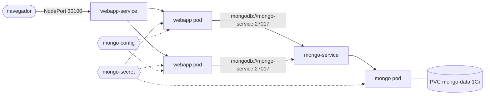

# minikube-practice

[](https://github.com/jadefigueredo/minikube-practice/actions/workflows/ci.yml)

Uma aplicação web com MongoDB rodando em Kubernetes local, montada para praticar o que importa em produção: health checks, limites de recursos, segredos fora do Git, armazenamento persistente e um teste de ponta a ponta no CI.

## Arquitetura



Tudo fica no namespace `minikube-practice`.

| Recurso | O quê | Por quê |
| --- | --- | --- |
| `webapp` Deployment | 2 réplicas da [aplicação de exemplo](https://hub.docker.com/r/nanajanashia/k8s-demo-app) | Duas réplicas mostram o Service balanceando e permitem rolling update sem indisponibilidade |
| `webapp-service` | NodePort 30100 | Acesso de fora do cluster no minikube |
| `mongo` Deployment | MongoDB 8.0, estratégia `Recreate` | O volume é ReadWriteOnce: o pod antigo precisa sair antes do novo montar |
| `mongo-data` PVC | 1Gi | Os dados sobrevivem a restart e redeploy do pod |
| `mongo-service` | ClusterIP 27017 | Banco acessível só de dentro do cluster |
| `mongo-secret` | gerado pelo Kustomize a partir de `k8s/.env.secret` | Credenciais fora do Git; o nome leva um hash do conteúdo, então trocar a senha reinicia os pods |
| `mongo-config` | gerado pelo Kustomize | Endereço do banco para a aplicação |

### Probes

- **Mongo, readiness:** `mongosh` executa `ping`. O pod só recebe tráfego quando o servidor responde, não apenas quando a porta abre.
- **Mongo, liveness:** TCP na 27017, com 30s de folga inicial para o banco subir. Um ping lento não deve reiniciar o banco.
- **Webapp, readiness:** `GET /` precisa responder 2xx/3xx.
- **Webapp, liveness:** TCP na 3000. Se o processo travar, o kubelet reinicia o container.

A separação é proposital: readiness pode ser exigente, porque só tira o pod do balanceamento; liveness precisa ser tolerante, porque reinicia o container.

### Recursos

Os dois containers declaram `requests` de CPU e memória, para o scheduler saber onde cabem, e `limits` só de memória. Limite de CPU causa throttling mesmo com o nó ocioso; limite de memória evita que um vazamento derrube o nó.

## Como rodar

Pré-requisitos: [minikube](https://minikube.sigs.k8s.io/docs/start/) e `kubectl`.

```bash
make start    # sobe o minikube
make deploy   # cria k8s/.env.secret a partir do exemplo, aplica tudo e espera os pods
make url      # imprime a URL da aplicação
make smoke    # testa a aplicação via port-forward
make status   # pods, services e volume
make delete   # remove o namespace (inclusive os dados)
```

Antes do primeiro `make deploy`, se quiser outra senha, copie `k8s/.env.secret.example` para `k8s/.env.secret` e edite. Esse arquivo está no `.gitignore`.

## CI

A cada push e pull request:

1. **validate:** renderiza os manifests com `kubectl kustomize` e valida contra o schema do Kubernetes com `kubeconform --strict`.
2. **e2e:** sobe um cluster [kind](https://kind.sigs.k8s.io/), roda `make deploy` (que espera os rollouts e, portanto, as probes) e `make smoke`. Se algo falhar, o job imprime `describe` e os logs dos pods.

## O que mudou desde a primeira versão

A primeira versão, escrita acompanhando um tutorial, tinha erros que só aparecem quando se aplica de fato no cluster: o Deployment do Mongo se chamava `nginx-deployment`, os Services usavam seletores que não batiam com os labels dos pods, a aplicação usava a imagem do Mongo e lia `USER_PSWD` em vez de `USER_PWD`, e o ConfigMap apontava para um Service com outro nome. O teste de ponta a ponta no CI existe para que esse tipo de erro não passe de novo.
